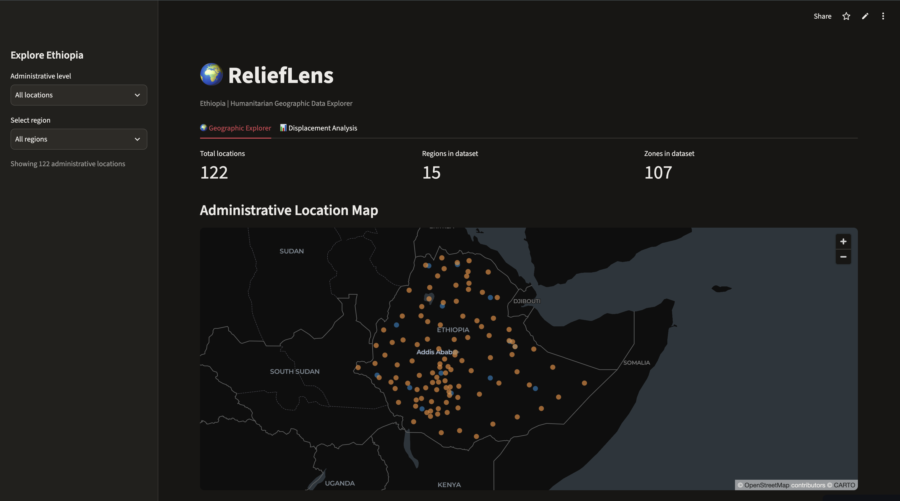

# 🌍 ReliefLens

**An Interactive Humanitarian Geographic and Displacement Data Explorer for Ethiopia**

**[Live Dashboard](https://relieflens.streamlit.app/)** | **[GitHub Repository](https://github.com/tkorga/relieflens)**
## Dashboard Preview



ReliefLens is a Python-based humanitarian data exploration dashboard that combines Ethiopian administrative geographic information with historical displacement observations from the International Organization for Migration (IOM) Displacement Tracking Matrix (DTM).

Built using Streamlit, Pandas, and PyDeck, ReliefLens allows users to explore administrative locations, analyze historical displacement reporting patterns, examine regional reporting coverage, and assess data quality.

The project focuses on making complex humanitarian datasets easier to explore while clearly communicating their limitations.

**Project status:** Deployed research prototype with interactive geographic exploration, historical displacement analysis, regional reporting coverage, and automated data validation.

**Data coverage:** 122 administrative reference locations and 1,206 historical IOM displacement observations spanning 2017–2024.

**Important:** ReliefLens is not a real-time humanitarian monitoring system. Its historical observations should not be interpreted as current displacement estimates or independently verified humanitarian needs.

## Features

### 1. Geographic Explorer

- **Interactive Ethiopia map:** Visualize 122 administrative reference locations, including 15 region-level and 107 zone-level records.
- **Geographic filtering:** Explore locations by region and administrative level.
- **Administrative data table:** Inspect location names, identifiers, coordinates, and parent-child relationships.
- **Data quality dashboard:** Review automated checks for missing identifiers, duplicate IDs, invalid administrative levels, invalid coordinates, and invalid parent references.

### 2. Historical Displacement Analysis

- **IOM DTM integration:** Explore 1,206 historical displacement observations from Ethiopia, covering reporting years 2017–2024.
- **Interactive filters:** Filter observations by monitoring operation, reporting date, and destination region.
- **Displacement reasons:** Examine observation counts associated with different displacement reasons.
- **Historical trends:** Explore reported IDP population values over time for a selected destination region, origin region, displacement reason, and monitoring operation.
- **Observation records:** Inspect displacement records in an interactive table.

### 3. Regional Reporting Coverage

- **Coverage metrics:** View the number and percentage of administrative reference regions represented in a selected reporting period.
- **Regional comparison:** Compare observation counts across destination regions.
- **Missing-region detection:** Identify reference regions without observations for the selected monitoring operation and reporting date.

Reporting coverage describes the availability of observations, not the severity of displacement. Missing observations do not imply zero displaced people.

### 4. Data Engineering and Validation

- **Data processing:** Load, clean, and validate administrative and displacement datasets using Python and Pandas.
- **API integration:** Retrieve displacement observations through the IOM DTM API.
- **Data integrity checks:** Validate administrative records and detect duplicate displacement observation keys.
- **Automated testing:** Run 15 unit tests covering administrative validation and IOM-related functionality.
- **Cloud deployment:** Access the dashboard through Streamlit Community Cloud.

## Technology Stack

| Technology | Purpose |
|---|---|
| Python | Data processing and application logic |
| Pandas | Data loading, cleaning, and validation |
| Streamlit | Interactive web dashboard |
| PyDeck | Geographic visualization |
| Plotly | Data visualization |
| Requests | IOM DTM API integration |
| Pytest | Automated testing |
| Git and GitHub | Version control |
| Streamlit Community Cloud | Application hosting |

## Data Sources

### 1. Ethiopian Administrative Data

**Source:** [Open Admin Data: Ethiopia Administrative Divisions](https://github.com/open-admin-data/ethiopia-administrative-divisions)

**License:** [Creative Commons Attribution 4.0 International (CC BY 4.0)](https://creativecommons.org/licenses/by/4.0/)

**Attribution:** Original dataset credited to jakkkrapongt. Administrative data was processed and cleaned for use in ReliefLens.

The administrative dataset contains:

- 122 administrative location records
- 15 region-level records
- 107 zone-level records
- 19 data columns

The dataset includes administrative names, identifiers, parent-child relationships, and geographic point coordinates.

**Important:** These coordinates represent administrative reference points, not administrative boundary polygons.

Administrative locations should not be interpreted as evidence of current humanitarian conditions.

### 2. IOM Displacement Tracking Matrix (DTM)

**Source:** International Organization for Migration (IOM), Displacement Tracking Matrix API v3.

ReliefLens integrates historical displacement observations for Ethiopia.

The dataset used during development contains:

- 1,206 displacement observations
- Reporting years from 2017 to 2024
- Destination and origin administrative regions
- Reporting dates and monitoring operations
- Displacement reasons
- Reported internally displaced person (IDP) population values

The application distinguishes monitoring operations and allows users to explore reporting periods individually.

**Data access:** Displacement observations are retrieved through the IOM DTM API using an API key. The local JSON snapshot is excluded from version control.

The public deployment retrieves observations using credentials configured privately in Streamlit Community Cloud.

**Limitations:**

- The observations are historical, not real-time estimates.
- Different monitoring operations and reporting periods should not automatically be treated as directly comparable.
- Multiple observations may exist for the same region and date because of different origins or displacement reasons.
- Population values should not be summed into regional or national totals without verifying the source methodology.
- Missing regional observations do not indicate zero displaced people.
- Administrative reference codes do not independently establish consistent historical boundaries.

## Data Validation

ReliefLens includes automated administrative data checks for:

1. Missing identifiers
2. Duplicate identifiers
3. Invalid administrative levels
4. Invalid geographic coordinates
5. Invalid parent references

The administrative dataset passed all five configured checks during development.

Displacement data validation includes checks for required fields, population values, and duplicate observation keys.

The project currently includes **15 automated tests**.

These checks assess structural consistency. They do not independently verify the accuracy, completeness, or currency of the original data.

## Getting Started

### 1. Clone the repository

```bash
git clone https://github.com/tkorga/relieflens.git
cd relieflens
```

*Note: Access to the repository is required while it remains private.*

### 2. Create a virtual environment

```bash
python3 -m venv .venv
source .venv/bin/activate
```

### 3. Install dependencies

```bash
python -m pip install -r requirements.txt
```

### 4. Configure IOM API access

Obtain an API key through the IOM DTM API's authorized access process.

Create a local `.env` file in the project root:

```dotenv
IOM_DTM_API_KEY="YOUR_API_KEY"
```

Replace `YOUR_API_KEY` with your own credential.

The `.env` file is excluded from Git version control. Never commit API credentials.

### 5. Run the dashboard

```bash
python -m streamlit run app.py
```

Streamlit will provide a local URL, usually `http://localhost:8501`.

If a local displacement snapshot exists, ReliefLens uses it. Otherwise, it retrieves observations from the IOM API.

### 6. Run automated tests

```bash
python -m pytest tests/ -v
```

### 7. Regenerate the administrative data validation report

```bash
python -m src.inspect_data
```

## Project Structure

```text
relieflens/
├── app.py
├── data/
│   ├── raw/
│   │   ├── ethiopia_admin.csv
│   │   └── iom_dtm/
│   │       └── ethiopia_admin1.json
│   └── processed/
│       └── ethiopia_admin_clean.csv
├── reports/
│   └── data_profile.json
├── src/
│   ├── __init__.py
│   ├── displacement.py
│   ├── iom_dtm.py
│   ├── inspect_data.py
│   └── validation.py
├── tests/
│   ├── test_iom_dtm.py
│   └── test_validation.py
├── .gitignore
├── requirements.txt
└── README.md
```

**Note:** `data/raw/iom_dtm/ethiopia_admin1.json` is a locally generated snapshot and is not committed to GitHub.

## Future Development

Potential improvements include:

- Expanding geographic and historical reporting coverage.
- Adding clearer data provenance and reporting-period metadata.
- Developing additional comparisons where the IOM methodology supports them.
- Supporting downloadable summaries with appropriate source attribution.
- Improving deployment reliability and automated testing.
- Adding humanitarian indicators from additional verified sources.

New indicators will be distinguished from administrative reference data and historical displacement observations.

## Responsible Data Use

ReliefLens is an exploratory research prototype, not an operational humanitarian decision-making system.

The dashboard does not independently measure current humanitarian needs, disaster severity, population vulnerability, or aid requirements.

Users should review the original sources, reporting dates, geographic coverage, assessment methods, and limitations before drawing conclusions from the visualizations.

## Author

**Tigistu Korga**  
Computer Science, Whitman College

GitHub: [@tkorga](https://github.com/tkorga)

## Acknowledgments

Administrative reference data provided by Open Admin Data.

Historical displacement observations provided through the International Organization for Migration's Displacement Tracking Matrix API.

Geographic basemap attribution is displayed within the application.

## License

ReliefLens's original application code is licensed under the [MIT License](LICENSE).

Third-party datasets retain their respective licenses and usage restrictions. Ethiopian administrative data is attributed to Open Admin Data under CC BY 4.0. IOM DTM displacement data remains subject to IOM's applicable terms and permissions.

The MIT License does not grant additional rights to third-party data.